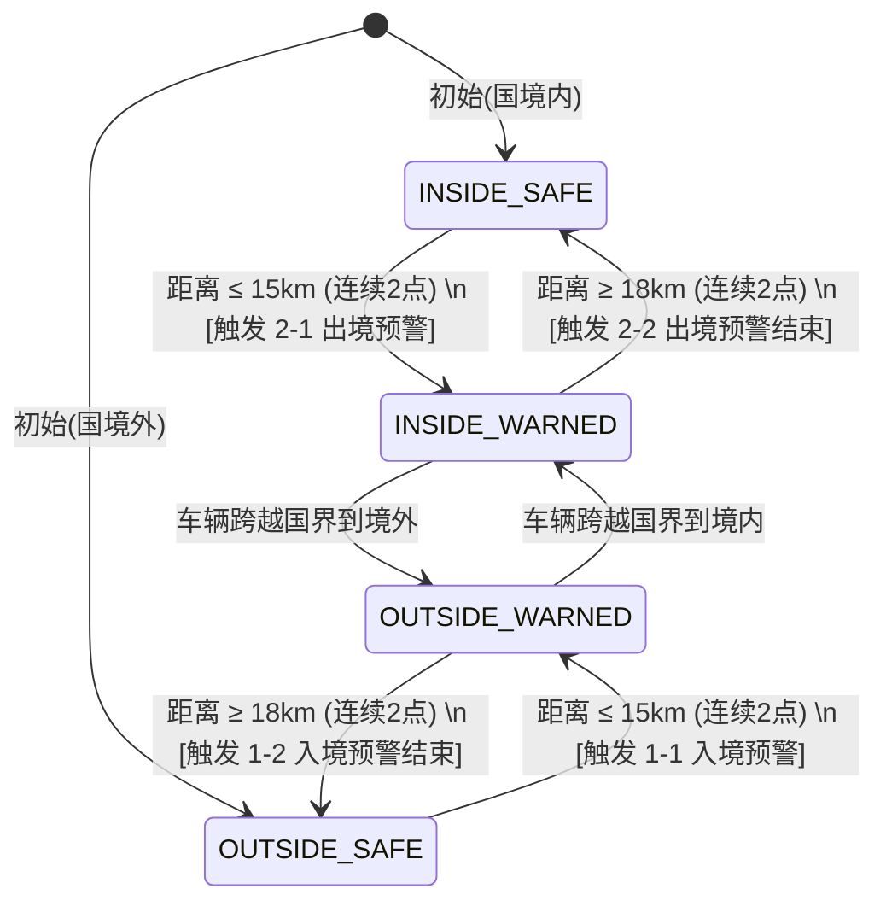

## 1. 业务概述与定位

- **系统定位**：基于 Apache Flink 流式计算引擎，针对海内外运营车辆的实时 GPS 轨迹点进行毫秒级空间几何判定。
    
- **业务目标**：实时识别车辆接近国境线、跨出国境（出境）或跨入国境（入境）的全过程，生成精准的预警与越境事件，支撑车队安全风控、防盗防越境以及跨境物流调度。
    

---

## 2. 报警事件定义与编码规范 (CrossBorder Codes)

国境报警按**出境 (OUTBOUND)** 和 **入境 (INBOUND)** 两个业务方向分类，每个方向包含**预警开始 (START)** 与 **预警结束 (END)** 两个状态：

|编码 (`crossBorder`)|事件名称|触发语义|空间位置与触发条件|
|---|---|---|---|
|**`2-1`**|**出境预警开始** (Outbound Start)|车辆由国内向国界靠近，进入预警距离|车辆位于**国境内侧**，且距离国界线 **≤ 15 km**（连续 2 点确认）|
|**`2-2`**|**出境预警结束** (Outbound End)|车辆完成出境或彻底退回国内安全深处|车辆**跨越国界驶入境外**，或退回国内且距离国界 **≥ 18 km**（连续 2 点确认）|
|**`1-1`**|**入境预警开始** (Inbound Start)|车辆由境外向国界靠近，进入预警距离|车辆位于**国境外侧**，且距离国界线 **≤ 15 km**（连续 2 点确认）|
|**`1-2`**|**入境预警结束** (Inbound End)|车辆完成入境或彻底退回境外安全深处|车辆**跨越国界驶入境内**，或退回境外且距离国界 **≥ 18 km**（连续 2 点确认）|

---

## 3. 流计算空间几何判定 (Border Geometry)

1. **国家边界多边形**：加载官方国界 GeoJSON 矢量多边形地图（如南非国界矢量图）。
    
2. **空间包含判定 (`Side`)**：利用 JTS (Java Topology Suite) 空间几何引擎判定车辆坐标 `(lng, lat)`：
    
    - **`INSIDE` (国境内)**：坐标落入国家多边形内部。
        
    - **`OUTSIDE` (国境外)**：坐标落入国家多边形外部。
        
3. **边界最短距离 (`DistanceKm`)**：采用空间 R 树索引 (`STRtree`) 快速检索邻近国界线段，计算车辆距离国界线的球面最短距离（单位：km）。
    

---

## 4. 四态状态机与防抖消除机制

### 4.1 状态区划模型 (Warning Zones)

车辆在流计算运行时归属以下 4 种区域状态之一：

- `INSIDE_SAFE`：国境内侧 - 安全区（距离国界 > 15 km）
    
- `INSIDE_WARNED`：国境内侧 - 预警区（距离国界 ≤ 15 km）
    
- `OUTSIDE_SAFE`：国境外侧 - 安全区（距离国界 > 15 km）
    
- `OUTSIDE_WARNED`：国境外侧 - 预警区（距离国界 ≤ 15 km）
    

### 4.2 抖动防护与滞后回差 (Hysteresis Zone)

为解决车辆在边界临界线处因 GPS 信号微小漂移或沿边界平行开晃动导致的频繁误报、重复刷屏问题，系统设计了双重防抖：

1. **连续点确认 (Counter De-noising)**：
    
    - **触发预警**：需连续 **2 个 GPS 点** 处于预警距离（`≤ 15 km`）内才真正发射 `START` 报警。
        
    - **解除预警**：需连续 **2 个 GPS 点** 距离国界超出重置距离（`≥ 18 km`）才真正发射 `END` 结束预警。
        
2. **3 km 滞后回差 (Hysteresis)**：
    
    - **预警触发阈值**：`warningDistanceKm`（默认 **15 km**）。
        
    - **预警解除阈值**：`resetDistanceKm = warningDistanceKm + 3 km`（默认 **18 km**）。
        
    - **作用**：在 15km ~ 18km 之间建立 3km 的物理缓冲区。车辆在此缓冲区内挪动或小幅飘移时，系统保持当前预警状态不变，避免产生乒乓震荡报警。
        

---

## 5. 方向判定与规则匹配机制

### 5.1 方向 (Direction) 的核心含义

系统中的“方向”**控制的不是车辆瞬时的车头角度/方向盘朝向**，而是控制：

1. **报警事件的业务性质**：推导输出的是出境消息还是入境消息。
    
2. **规则的精准过滤**：根据用户关注的风险控制消息弹窗与屏蔽。
    
3. **状态机的参照系起点**：确定是以国内还是国外作为安全基准。
    

### 5.2 规则方向过滤 (Rule Direction Filtering)

产品后台支持配置规则方向为 `OUTBOUND`（只看完出境）、`INBOUND`（只看完入境）或全部：

- 若车辆正从国内靠近国界（推导出 `OUTBOUND`），但商户规则配置为 `INBOUND`，流计算算子会自动**抑制 (Suppress) 该事件**，不对用户推送。
    

---

## 6. 边缘场景逻辑设计 (如 13km ➔ 14km 场景)

- **场景描述**：车辆原本在安全区，第 1 个点距离国界 13km，第 2 个点距离 14km（虽离国界更远了，但均满足 `≤ 15km`）。
    
- **处理结果**：系统**正常触发预警**。
    
- **设计Rationale**：
    
    1. **地理风控原则**：预警核心是空间风控，只要身处 15km 敏感高风险区域，即具备越境风险，原则是“宁可提前提醒，不可漏报”。
        
    2. **路网弯道兼容**：边境公路多为 S 型弯道或平行公路，车辆沿弯道绕行时距离可能短暂变大，若强制要求后一点必须更近，会导致弯道场景严重漏报。
        
    3. **自动纠错**：若车辆后续真正掉头驶离国内，当远离至 18km 以外时，系统会自动触发 `END` 预警结束，形成完整闭环。
        

---

## 7. 规则作用域与优先级仲裁

当同一辆车满足多条规则（如车辆规则、车队规则、集团规则）时，系统采用以下**降序仲裁逻辑**确定生效规则：

1. **作用域等级 (Scope Rank)**： `车辆指定规则 (Vehicle Scope)` > `直属组织/车队规则 (Direct Org)` > `上级父组织规则 (Ancestor Org)`
    
2. **仲裁判定 (Beats Arbitration)**： 若作用域层级相同，按 `组织树层级深度` > `规则更新时间 (UpdateTime)` > `规则修订版本号 (Revision)` 比较。
    

---

## 8. 数据质量与防错控制

1. **离线补报轨迹过滤**：自动识别并过滤离线补发轨迹 (`isPatch == true`)，仅对实时在线定位点进行预警判定。
    
2. **坐标合法性校验**：自动剔除经纬度超出物理范围 (`lat ∉ [-90, 90]` 或 `lng ∉ [-180, 180]`) 的异常噪点。
    
3. **乱序时间戳丢弃**：单车维度的 GPS 时间戳必须严格单调递增，凡小于等于已知最新 `gpsTimeStamp` 的迟到/乱序点直接忽略，防止状态机倒转。
    
4. **生命周期 UUID 追踪**：每次从 `START` 到 `END` 的完整预警周期生成唯一 `UUID`，方便上层业务系统做同一次预警事件的闭环跟踪与归档。