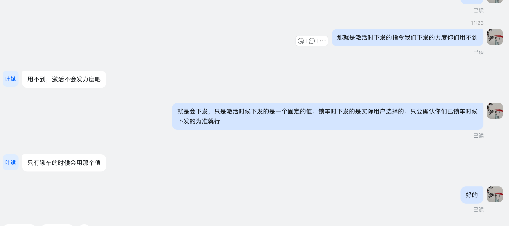

# 激活与锁车力度值沟通

- Capture Time: 2026-09-14 11:29（按截图文件名，Asia/Shanghai）
- Conversation Time: 待确认（截图仅显示 11:23，日期不可见）
- People: 左侧头像文字疑似“叶斌”，身份待确认；右侧发言人待确认
- Domain: overseas-telematics
- Processed: 2026-09-14
- 原始入口：inbox/assets/chat/staging/2026-09-14-1129-1789356542655-chat.png
- 记录方式：整理时根据独立截图补录；原先没有配套捕获页
- 领域判断：根据车辆激活、锁车及力度值语义归入海外车联网；截图未说明国家、项目或控制器型号

## 截图原件

## 可辨认原文

以下按截图可见顺序转录，省略已读标记；截图上方有截断内容，未补猜。

1. 右侧（11:23）：“那就是激活时下发的指令我们下发的力度你们用不到”
2. 左侧：“用不到，激活不会发力度吧”
3. 右侧：“就是会下发，只是激活时候下发的是一个固定的值。锁车时下发的是实际用户选择的。只要确认你们已锁车时候下发的为准就行”
4. 左侧：“只有锁车的时候会用那个值”
5. 右侧：“好的”

第 3 条中的“已锁车”按截图保留，结合上下文可能表达“以锁车时候下发的为准”，属于释义，未改写原文。
